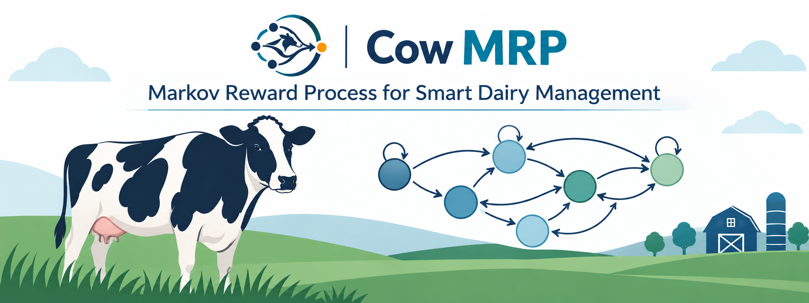

# CowMRP (`cowmrp`)

Markov reward process (MRP) models of dairy cattle, as a Python package. A **domain-free MRP engine** (`cowmrp.mrp`) plus two animal domains:
the **cow** (state `(lactation, dim, dp)`: lactation number, days in milk, days pregnant, in model-step units) and the **youngstock** chain
(calf, heifer, first calving). The engine knows no animal, so you can write your own domain.

It is for researchers and farm advisers who want to value cows (keep or replace), project a herd forward, and look at environmental outputs
beside economic ones. The scientific model is the reference implementation; the package changes how it is reached, not what it computes.

## Install

```
pip install cowmrp                 # engine + domains (numpy, pandas, scipy)
pip install "cowmrp[plot]"         # + matplotlib, plotly: dashboards and projection figures
pip install -e ".[dev,plot,parquet]"       # from a clone of this repository (Python 3.10 or newer)
```

The installed package contains the engine, the domains, the plotting helpers and the 200-cow tutorial herd. The runner scripts (`runners/`), `examples/`,
`user_examples/` (the example notebooks), the tests and the documentation sources are in the source repository, https://github.com/Bovi-analytics/cow-mrp; the commands in
"Running the scripts" and "Tests" below are for a clone.

## Quick start: a whole farm in a few lines

```python
from cowmrp.data import example_herd_path            # 200 synthetic cows shipped with the package
from cowmrp.model import build_model
from cowmrp.domains.cow.farm import load_herd, project_herd
from cowmrp.viz.farm import write_farm_outputs

model = build_model("cow")                            # month resolution (see "Time resolution")
herd = load_herd(example_herd_path(), model)          # or your own CSV / DataFrame
result = project_herd(herd, model, mode="expected", steps=24)
write_farm_outputs(result, "farm_results")            # CSV tables + dashboard.html + dashboard_plotly.html
```

**Example notebooks.** The folder [`user_examples/`](user_examples/) holds five Jupyter notebooks that start with `pip install "cowmrp[plot,excel]"`, import only from the installed package and run on a CSV that you replace with your own: cows from a CSV with keep/cull, a farm projection with the interactive Plotly dashboard, individual rewards, a youngstock farm, and a domain of your own on the generic engine. They are not part of the installed package; get them with `git clone https://github.com/Bovi-analytics/cow-mrp.git` (or Download ZIP on GitHub) and see `user_examples/README.md` and the Examples page of the documentation site.

A complete script is `examples/whole_farm_example.py`; the same steps are walked through in the [tutorial](https://bovi-analytics.github.io/cow-mrp/tutorial.html) of the documentation site (online once the repository is public; the source is `guide/tutorial.html`).

## What the package does

| Task | Entry point | Notes |
|---|---|---|
| Build and solve a model | `cowmrp.model.build_model("cow" \| "youngstock")`, `evaluate`, `evolve_distribution` | Any domain that follows the interface in `cowmrp.domain` |
| **One cow, or cow A against cow B** | `cowmrp.domains.cow.projection.compare_cows(scenarios, years=2)` | Rewards and distributions over time for cows given as `lactation`, `dim_days`, `dp_days`; figures in `cowmrp.viz.projection` |
| **Keep or cull** | `cowmrp.domains.cow.keepcull.keep_cull_table(herd, model, years=(1,3,5), offer=900)` | Break-even sale value of every cow = value of keeping her minus value of replacing her now; a KEEP/CULL call only when you give an `offer`. Salvage is not credited in the model's own comparison (a documented limitation). `cowmrp.domains.cow.keepcull_excel.write_keepcull_workbook` (`--excel`, needs `cowmrp[excel]`) writes an Excel workbook that shows the sale of the cow now as its own column; see below |
| **Whole-farm projection** | `cowmrp.domains.cow.farm.project_herd(herd, model, mode, steps)` | Open / pregnant / dry, lactation, DIM stage; cows never replaced versus replaced; per-cow values |
| **Load farm records** | `cowmrp.domains.cow.farm.load_herd(csv_or_dataframe, model)` | Raw records or already-mapped `state_id`; every problem reported with row and `cow_id` |
| Environmental outputs | `cowmrp.domains.cow.rewards.environment` | The physical quantities (enteric and manure methane, N2O, nitrogen, CO2) are always computed by `compute_environment()` and do not depend on any price; the monetary environmental rewards are off by default and enter the economic total only if you enable them |
| Synthetic herd | `cowmrp.domains.cow.farm.generate_herd(model, mode, n_cows, seed)` | `equilibrium` (the model's steady-state herd), `mix`, `exact` |

### Farm data

One row per cow, described in **real days** (never health or DNB flags, which are not state variables):

| Column | Meaning |
|---|---|
| `cow_id` | optional, unique (1..n when absent) |
| `lactation` | 1 to 10 |
| `dim_days` | days in milk, 0 or more |
| `dp_days` | days pregnant, 0 for an open cow (default 0) |
| `state_id` | alternative: the model state of the cow, as written by `generate_herd` (if given together with the days they must agree) |
| `uim`, `up` | alternative to the days columns: the model's step indices |

A cow is mapped to a state exactly as the original runner `runners/cow/farm/generate.py` always did. `load_herd` adds checks only: missing columns, non-numeric
values, out-of-range lactation, negative days, duplicate `cow_id`, a combination the model has no state for (the message lists the nearest valid states), and a herd
file made under another time resolution. A DataFrame is accepted wherever a CSV path is.

### Tutorial dataset

`cowmrp.data.example_herd_path()` is a 200-cow **synthetic** herd (cows drawn from the model's own steady-state herd, seed 42, month resolution) in the model's schema;
`example_raw_herd_path()` is the same cows as a farmer would export them (`cow_id, lactation, dim_days, dp_days`). No real farm records are included.

### Time resolution

The model steps in `month` (30 d, default), `week` (7 d) or `day` (1 d). Set it **before Python starts**: `COW_TIME_UNIT=week python my_script.py`.
The resolution is not a display setting: it rebuilds the state space, the transition probabilities (rescaled to the step), the reward of every state (the rate integrated over the days
one step spans) and so the expected values. `dim` and `dp` are step indices of the chosen resolution, not calendar days; durations such as gestation stay in real days.
One process holds one resolution (the cow domain reads it once, when imported); `compare_cows` runs scenarios of another resolution in worker processes for you.
A herd file made at one resolution is refused at another; regenerate it. The day resolution is large: use it deliberately.

<!-- GEN:resolution_table -->
| Resolution | Step | States | Transitions | Example cow as `(dim, dp)` |
|---|---:|---:|---:|---:|
| month | 30 d | 2,970 | 9,040 | (4, 2) |
| week | 7 d | 42,290 | 131,197 | (20, 9) |
| day | 1 d | 1,952,060 | 6,109,989 | (149, 60) |

The example cow is in her second lactation, 150 days in milk and 60 days pregnant; `dim` and `dp` count model steps, so the same cow has different state coordinates at each resolution.
<!-- /GEN -->

<!-- GEN:state_counts -->
State counts (month resolution): 2,970 states, of which 1,210 are reachable from the replacement state (the default is the full table), 9,040 transitions.
<!-- /GEN -->

### Expected versus stochastic and Monte Carlo

`project_herd(..., mode=...)`:

| Mode | What it computes | When to use |
|---|---|---|
| `expected` (default) | The exact distribution of the herd after each step, split into cows never replaced and cows replaced at least once. Deterministic, fast | Almost always: planning, comparing scenarios, dashboards |
| `stochastic` | One sampled path per cow (`seed`) | To see a single plausible herd history |
| `monte_carlo` | Many sampled herds (`sims`), reported as mean, standard deviation, 5th and 95th percentile | When the spread, not only the mean, matters (small herds) |

For a large herd the three agree on the mean; Monte Carlo is the slow one, so it is never run unless you select it.

## Repository layout

| Folder | Purpose |
|---|---|
| `src/cowmrp/mrp/` | Domain-free MRP engine: `core.py` (math), `engine.py` (spec orchestration and validation), `simulator.py`, `utils.py` |
| `src/cowmrp/domain.py`, `model.py` | The domain interface (`load_domain`, `validate_domain`) and the generic build/solve API |
| `src/cowmrp/domains/` | One folder per domain: `cow/` (parameters, states, probabilities, transitions, rewards, lookup tables, evidence, `farm.py`, `keepcull.py`, `projection.py`) and `youngstock/` |
| `src/cowmrp/viz/`, `io/`, `data/` | Figures and dashboards, model-file export, the shipped example herd |
| `runners/` | Scripts that use the package: one module per domain (`cow/`, `youngstock/`) with `run.py`, `checks/`, `plots/`, `outputs/<kind>/`; `_shared/` common code |
| `examples/` | Four runnable scripts (`whole_farm_example.py`, ...) |
| `user_examples/` | Five example notebooks with their synthetic CSV files, a custom-domain folder and the installed-wheel test (`check_installed.py`); obtained from GitHub, not in the package |
| `tests/` | Fast default suite plus opt-in `slow` and `install` tests (see `tests/README.md`) |
| `guide/` | Documentation: the tutorial, a file guide and API reference built by `guide/build.py`, and the website in `guide/web/` |

Dependency direction is one-way: `cowmrp.mrp` <- `cowmrp.domain` <- `cowmrp.model` <- `cowmrp.domains` <- `runners`
(check: `python runners/_shared/checks/verify_mrp_boundary.py`). `runners/README.md` explains the runner modules.

**Add a domain:** write a package with `parameters`, `states`, `probabilities`, `transitions` (and optional `rewards`) following `cowmrp.domain`, then
`cowmrp.domain.load_domain("your_package")`. `python runners/_shared/new_domain.py <name>` creates the stubs and the runner module.

## Running the scripts (research workflows)

All scripts run from any directory. They are kept and call the package.

```
python runners/run_all.py                         # every module -> runners/<module>/outputs/
python runners/cow/run.py --review                # review pages for a domain expert
python runners/cow/projection.py                  # edit SCENARIOS at the top first (cow A vs cow B)
python runners/cow/farm/generate.py               # a synthetic herd -> runners/cow/outputs/farm/farm_data.csv
python runners/cow/farm/simulate.py --mode expected --steps 24     # herd projection and dashboards
python runners/cow/farm/keepcull.py --years 1,3,5 --offer 900      # keep/cull table
python runners/cow/farm/keepcull.py --excel                    # + keepcull_accounting.xlsx: KEEP, REPLACE, salvage, break-even per cow (needs cowmrp[excel])
python runners/cow/farm/keepcull.py --set REARING_COST=2800      # scenario run: override an economic setting for this run only (see below)
python runners/cow/checks/verify_farm.py          # and the other verify_* scripts in runners/*/checks/
python runners/_shared/scale_benchmark.py --quick # cost and accuracy against herd size
```

### Keeping the documentation in step with the code

Numbers and tables that the documents repeat (state counts, reward components, overridable economic settings) are read from the package, not typed:

```
python guide/build_all.py              # rewrite the generated blocks, build both sites, then check that nothing is stale
python guide/sync.py check             # exit 1 if a block, token, number or built site is out of date
python guide/sync.py impact <file>     # which documents and outputs depend on a source file
```

Generated blocks sit between `<!-- GEN:name -->` and `<!-- /GEN -->` in this file; do not edit inside them. `{{NAME}}` tokens in the tutorial and site pages are expanded at build time.

### Keep/cull accounting workbook

`python runners/cow/farm/keepcull.py --excel` also writes `keepcull_accounting.xlsx`: for every cow and horizon, the KEEP value, the REPLACE value, the immediate salvage (an indicative estimate, or the net offer you type for that cow), the break-even offer, ΔQ and the decision, as Excel formulas. It is a reporting output; the model, the reward vector and `keep_cull_table` are unchanged. The estimate is indicative (state-based body weight; the model's dressing percentage, beef price and culling fee) and a typed offer is the net cash received. The `Checks` sheet shows that the break-even column reproduces `keep_cull_table`. Terms, every column and formula, the treatment of future salvage and replacement costs, and the limitations are on the documentation site page *Keep/cull workbook* (`guide/web/content/keepcull-workbook.html`). The column table below is generated from the package:

<!-- GEN:excel_columns -->
| Col | Header | Kind | Formula (row r) | Meaning |
|---|---|---|---|---|
| A | cow_id | from the herd file |  | Cow identifier from the herd file (row number if the herd has none). |
| B | state_id | from the herd file |  | Model state of the cow (index into the state table of the current time resolution). |
| C | lactation | from the herd file |  | Lactation number (copied when the herd has it). |
| D | dim_days | from the herd file |  | Days in milk (copied when the herd has it). |
| E | dp_days | from the herd file |  | Days pregnant (copied when the herd has it). |
| F | body_weight_kg (model, state-based) | model value (pasted) |  | Body weight of the state in kg, computed as cull_reward computes it for the salvage value. A model estimate, not the weight on the day of sale. |
| G | V_total(s) | model value (pasted) |  | V_total(s): expected discounted total reward of the cow over the horizon (milk, pregnancy, cull, mortality, feed, reproduction), future cull salvage included. |
| H | PV future replacement costs (s) | model value (pasted) |  | PV_rc(s): expected discounted cost of the future replacements of this cow and of her replacements over the horizon. |
| I | KEEP = V_total - PV_rc | Excel formula | `=Gr-Hr` | KEEP: expected future value of keeping the cow, every future replacement cost paid. |
| J | estimated salvage S_est | Excel formula | `=Fr*Inputs!$B$3*Inputs!$B$2-Inputs!$B$4` | Estimated salvage now: body weight x dressing percentage x beef price - culling fee (Inputs B3, B2, B4). |
| K | actual net offer (type here, optional) | input (yellow) |  | Actual net offer for this cow, typed by the user (optional). Net cash received: the culling fee is not subtracted again. |
| L | S used | Excel formula | `=IF(Kr="",Jr,Kr)` | Salvage used: the typed offer if there is one, otherwise the estimate. |
| M | V_keep(heifer) | Excel formula | `=Inputs!$E$<horizon row>` | V_keep(h): value of a fresh replacement heifer (state (1, 0, 0)) over the same horizon (Inputs sheet). |
| N | rearing cost C | Excel formula | `=Inputs!$B$<horizon row>` | C: rearing cost of one replacement, charged once, now (Inputs sheet). |
| O | REPLACE = S + V_keep(h) - C | Excel formula | `=Lr+Mr-Nr` | REPLACE: salvage used + value of the replacement heifer - rearing cost. |
| P | Delta Q = KEEP - REPLACE | Excel formula | `=Ir-Or` | Delta Q = KEEP - REPLACE. Positive: keeping is better; negative: replacing is better. |
| Q | break-even offer | Excel formula | `=Ir-Mr+Nr` | Break-even offer: the salvage at which KEEP and REPLACE are equal. |
| R | decision | Excel formula | `=IF(Lr>Qr,"CULL","KEEP")` | Decision: CULL when the salvage used is above the break-even offer, otherwise KEEP. |
| S | S source | Excel formula | `=IF(Kr="","estimate","offer")` | Which salvage was used: the estimate or a typed offer. |
| T | value from keep_cull_table (check) | check |  | value_<N>y from keep_cull_table for the same cow and horizon (pasted from the model). |
| U | difference to check | check | `=Qr-Tr` | Break-even offer minus the reference value; must be 0 (to rounding). |
<!-- /GEN -->

### Economic scenarios

Prices and costs of the cow rewards (milk, feed, beef, calf, rearing, culling fee and the service costs) can be overridden for one run, without touching the model's defaults:

```python
from cowmrp.model import build_model
from cowmrp.domains.cow.economics import economic_overrides, reprice_model
from cowmrp.domains.cow.keepcull import keep_cull_table

model = build_model("cow")
with economic_overrides(MILK_PRICE_PER_KG=0.52, REARING_COST=2800):
    scenario = reprice_model(model)            # rewards recomputed; states, probabilities and the transition matrix are the same objects
    table = keep_cull_table(herd, scenario)    # keep/cull inside the block, so REARING_COST applies
```

Settings not named keep their defaults, and every value is restored when the block ends. The discount rate and the sale offer are already arguments of the keep/cull functions.
The override replaces module-level values, so it is **not thread-safe**: use it in sequential scripts and notebooks. The supported settings, with unit, currency and the source recorded in the repository, are in `cowmrp.domains.cow.economics.ECONOMIC_SETTINGS`. Biological and management values are not overridable.

## Tests

```
pytest                    # fast set, about 1 minute: expected-distribution checks, month and week
pytest -m slow            # day resolution and weekly Monte Carlo parity, about 13 minutes
pytest -m install         # builds the wheel and installs it in a clean virtual environment (needs network)
```

## Documentation

The site is built from the code by `python guide/build.py` and published to GitHub Pages by `.github/workflows/guide.yml` when `src/`, `guide/`,
`examples/`, `user_examples/`, `README.md` or `pyproject.toml` change on `main`.

## License and citation

Authors: Sumit Sharma (first author, primary developer), Edward Hansen and Miel Hostens (supervisor), Department of Animal Science, Cornell University, Ithaca, New York, USA.
CowMRP is released under the MIT licence (SPDX `MIT`), see `LICENSE`. Copyright (c) 2026 Bovi-analytics Lab, Cornell University. How to cite: see `CITATION.cff` (archived release: [doi:10.5281/zenodo.24357536](https://doi.org/10.5281/zenodo.24357536)).

Third-party material keeps its own licence: the Computer Modern (CMU) web fonts bundled with the documentation theme (`guide/web/theme/fonts/`, not in the installed package) are under the SIL Open Font License 1.1, whose text (`OFL.txt`) is kept with them; the interactive dashboards embed plotly.js (MIT), which keeps its own notice in the generated files. Dependencies such as numpy, pandas, scipy, matplotlib, plotly and openpyxl are installed from PyPI under their own licences and are not redistributed here.

## Notes

- The state reward vector does not contain `replacement_cost`; it is charged in the cow-versus-heifer comparison
  (`replacement_comparison`, used by the keep/cull table), see the module docstring of `cowmrp.domains.cow.rewards`.
- Lookup tables can be overridden by CSV files (`src/cowmrp/domains/cow/data/README.md`).
- All generated files are written to `runners/<module>/outputs/`, which is not tracked.
